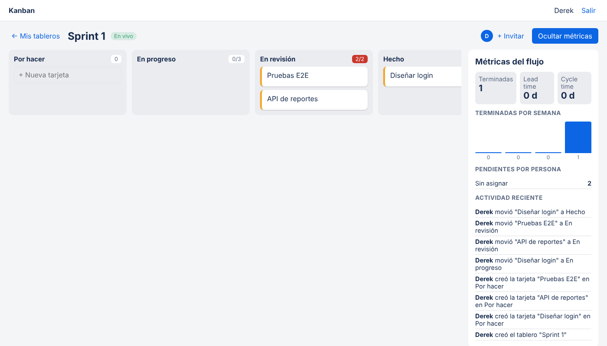

# Tablero Kanban en tiempo real

Aplicación web para organizar el trabajo de un equipo con el método Kanban. Varias personas pueden tener el mismo tablero abierto y ven los cambios al instante. Incluye límites de trabajo en curso (WIP) y métricas de flujo como lead time, cycle time y throughput.

**Stack:** TypeScript · Node.js · Express · Socket.IO · SQLite · React · Vite · Zod · Vitest



## Funcionalidades

- **Cuentas y tableros compartidos**: registro e inicio de sesión con JWT, claves cifradas con bcrypt. El creador del tablero es administrador e invita a otros por correo.
- **Columnas** Por hacer → En progreso → En revisión → Hecho, con **arrastrar y soltar** las tarjetas entre ellas y dentro de la misma columna.
- **Límite WIP por columna**: si "En progreso" tiene límite 3 y ya hay 3 tarjetas, el servidor rechaza la cuarta (409) y la interfaz lo avisa. Es la regla central de Kanban: terminar antes de empezar más cosas.
- **Tarjetas** con prioridad, responsable (solo miembros del tablero), fecha límite y descripción. Las vencidas se marcan en rojo.
- **Tiempo real**: cada tablero es una sala de Socket.IO; cuando alguien cambia algo, todos los que lo tienen abierto reciben el tablero actualizado.
- **Métricas de flujo**:
  - *Lead time*: días desde que se crea una tarjeta hasta que se termina (lo que espera quien la pidió).
  - *Cycle time*: días desde que se empieza a trabajar hasta que se termina (lo que tarda el equipo).
  - *Throughput*: tarjetas terminadas por semana en las últimas 4 semanas.
  - Pendientes por persona y tarjetas vencidas.
- **Historial de actividad** del tablero ("Ana movió 'Login' a En revisión").

## Decisiones técnicas

- **Las reglas viven en el servidor** (`server/src/kanban.ts`). El frontend no decide si se puede mover una tarjeta; solo muestra lo que el servidor permite. Así dos personas moviendo a la vez no pueden saltarse el límite WIP.
- **Movimientos en una transacción**: al mover una tarjeta se cierra el hueco en la columna de origen y se abre espacio en la de destino dentro de la misma transacción, para que las posiciones nunca queden repetidas.
- **Fechas de inicio y fin automáticas**: la tarjeta guarda cuándo salió por primera vez de "Por hacer" y cuándo llegó a "Hecho". Con eso se calculan las métricas sin pedirle nada extra al usuario. Si una tarjeta sale de "Hecho", deja de contar como terminada.
- **Validación con Zod** en cada endpoint: datos mal formados → 400 con el detalle por campo; regla de negocio violada → 409; sin permiso → 403.
- **Reloj inyectable** en la clase `Kanban`, para probar las métricas de tiempo sin esperar días reales.

## Cómo ejecutarlo

Desarrollo (dos terminales):

```bash
cd server && npm install && npm run dev     # API y WebSocket en :3000
cd client && npm install && npm run dev     # interfaz en :5173
```

Abre http://localhost:5173, crea una cuenta y un tablero. Para ver el tiempo real, abre el mismo tablero en otra ventana.

Con Docker (sirve frontend y backend juntos):

```bash
docker build -t tablero-kanban .
docker run -p 3000:3000 -v kanban-datos:/data -e JWT_SECRET=un-secreto-largo tablero-kanban
```

## Pruebas

```bash
cd server && npm test
```

18 pruebas con Vitest y Supertest: autenticación, permisos, límite WIP, reordenamiento de posiciones, métricas con reloj controlado y una prueba de Socket.IO que verifica que el cliente conectado recibe el cambio.

## API

| Método | Ruta | Descripción |
|---|---|---|
| POST | `/api/auth/registro`, `/api/auth/login` | Cuenta y token |
| GET/POST | `/api/tableros` | Mis tableros / crear |
| GET | `/api/tableros/:id` | Tablero con columnas y tarjetas |
| POST | `/api/tableros/:id/miembros` | Invitar por correo (admin) |
| GET | `/api/tableros/:id/metricas` | Métricas de flujo |
| GET | `/api/tableros/:id/actividad` | Historial |
| PATCH | `/api/columnas/:id` | Cambiar nombre o límite WIP (admin) |
| POST | `/api/tableros/:id/tarjetas` | Crear tarjeta |
| PATCH/DELETE | `/api/tarjetas/:id` | Editar / eliminar |
| POST | `/api/tarjetas/:id/mover` | Mover a `{ columna_id, posicion }` |

Evento de Socket.IO: el cliente emite `tablero:unirse` con el id y recibe `tablero:actualizado` con el tablero completo.

## Estructura

```
server/src/
  db.ts           esquema SQLite
  auth.ts         registro, login y middleware JWT
  kanban.ts       reglas del tablero (WIP, movimientos, permisos)
  metricas.ts     lead time, cycle time, throughput
  app.ts          rutas Express y manejo de errores
  tiempo-real.ts  salas de Socket.IO
client/src/
  components/     Login, ListaTableros, Tablero, EditarTarjeta, PanelMetricas
  api.ts          cliente HTTP con el token
```
